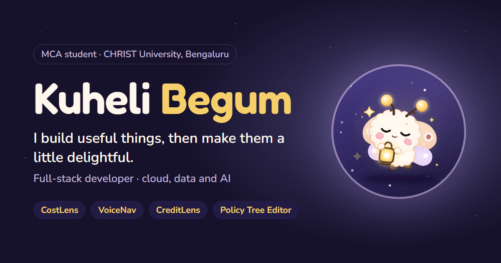

# Kuheli Begum · Portfolio

My personal site: the projects I've built, how each one works, and how to reach me. Lumi, the small moth from
my hackathon project, keeps watch in the corner.



## What's on it

- **Featured work:** CostLens, VoiceNav, CreditLens and Policy Tree Editor, each with its own case-study page
  (problem, approach, results and limits).
- **More projects:** MindCare, Sales Pulse, HubSpot Deals ETL, Highway Delite and DSA Revision Tracker.
- **Design work:** three mobile-first sites for small food businesses (Gulab & Co., Sip & Sage, Brew & Bounce).
- **Just for fun:** Lumi's Night Shift.
- About, education, awards, and contact links.

## Built with

- [Next.js 16](https://nextjs.org) (App Router, static prerendering) and TypeScript
- [Tailwind CSS 4](https://tailwindcss.com)
- Fredoka and Nunito through `next/font`

## Details

- **Two themes.** Night is the default and there is a light theme toggle. A small inline script applies a saved
  choice before the first paint, so the page doesn't flash.
- **Demo videos** are short, muted, compressed MP4s. They only play while on screen, never play when the
  system asks for reduced motion, and stay paused once you pause them.
- **Accessibility:** a skip link, visible focus rings, labelled controls, and colour pairs that meet WCAG AA
  contrast in both themes.
- **Content lives in data files**, so updating the site rarely means touching a component:
  - `src/data/profile.ts`: name, email and social links
  - `src/data/projects.ts`: case studies, smaller projects and design sites

## Run it locally

```bash
npm install
npm run dev
```

Then open http://localhost:3000.

```bash
npm run lint    # ESLint
npm run build   # production build
npm start       # serve the production build
```

## Project layout

```
src/
  app/                 routes, layout, global styles, icons and the social preview image
    projects/[slug]/   case-study pages
  components/          page sections and shared UI
  data/                profile and project content
public/
  media/               screenshots, demo videos and Lumi
  resume/              resume PDF
```
